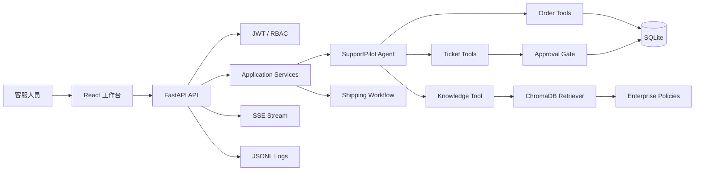

# SupportPilot

SupportPilot 是一个面向企业客服场景的智能客服 Agent 工作台。项目将大模型的自然语言理解能力与企业业务工具、RAG 知识库、确定性 Workflow 和人工审批结合，用于处理订单查询、政策问答、售后工单和物流异常。

项目重点解决三个问题：

- 企业政策回答必须来自内部知识库，减少模型凭常识回答。
- 订单和工单数据必须通过业务工具读取，避免模型编造业务数据。
- 创建工单、修改状态等写操作必须经过人工批准，避免未经授权的数据库写入。

## 产品能力

### Agent Tool Calling

Agent 可以根据用户意图调用业务工具：

- 查询单个订单详情
- 汇总全部物流订单数量和状态
- 查询工单状态
- 创建售后工单
- 修改工单状态
- 查询企业知识库

### 企业知识库 RAG

当前知识库包含：

- 物流政策
- 退款政策
- 退换货政策
- 会员政策

检索流程：

```text
用户问题
  ↓
文本切分
  ↓
BAAI/bge-small-zh-v1.5 向量化
  ↓
ChromaDB 检索
  ↓
相似度阈值过滤
  ↓
Agent 基于资料回答并返回来源
```

管理员可以在 Web 工作台上传 `.txt` 和 `.md` 文件，并触发知识库重新索引。

### 物流异常 Workflow

物流异常由确定性 Python Workflow 执行：

```text
查询订单
  ↓
检索物流政策
  ↓
判断是否超过发货时限
  ↓
检查同类型未解决工单
  ↓
复用已有工单或生成新工单审批
```

超时判断、工单幂等检查和数据库写入由代码执行，不交给模型自由发挥。

### Human-in-the-loop

以下动作必须经过人工审批：

- 创建售后工单
- 修改工单状态
- 创建物流异常工单

审批记录会保存到 SQLite。批准后才执行数据库写入，拒绝后不修改业务数据。

### Web 客服工作台

React 前端包含：

- 登录页和角色权限
- 客服对话工作台
- 历史会话和消息持久化
- SSE 流式 Agent 回复
- 订单中心
- 工单中心
- 审批中心
- 企业知识库管理
- Eval 和运行日志页面

## 系统架构



## 技术栈

### Backend

- Python 3.12
- FastAPI
- Uvicorn
- Pydantic
- OpenAI Agents SDK
- DeepSeek OpenAI-compatible API
- SQLite
- PyJWT

### Agent / RAG

- Agent Tool Calling
- ChromaDB
- sentence-transformers
- `BAAI/bge-small-zh-v1.5`
- 自定义文本切分和相似度阈值过滤
- 确定性 Workflow
- Human-in-the-loop Approval

### Frontend

- React
- TypeScript
- Vite
- REST API
- SSE 流式传输
- 原生 CSS 工作台布局

### Quality / Observability

- pytest
- RAG Eval
- Workflow Eval
- HITL Eval
- Agent Tool Eval
- Intent Route Eval
- JSONL Workflow、RAG、审批和回归日志

## 目录结构

```text
supportpilot-agent/
├── src/supportpilot/
│   ├── agent.py                 # Agent 指令和工具注册
│   ├── auth.py                  # JWT、密码哈希和角色权限
│   ├── config.py                # DeepSeek 模型配置
│   ├── db.py                    # SQLite Schema 和数据访问
│   ├── api/
│   │   └── app.py               # FastAPI API、SSE、上传和权限路由
│   ├── services/
│   │   └── chat_service.py      # Agent 对话服务
│   ├── tools/
│   │   ├── order_tools.py       # 订单工具
│   │   ├── ticket_tools.py      # 工单工具
│   │   └── kb_tools.py          # 知识库工具
│   ├── rag/
│   │   ├── chunker.py           # 文档切分
│   │   ├── ingest.py            # 知识库索引
│   │   └── retriever.py         # 向量检索
│   └── workflows/
│       └── shipping_workflow.py # 物流异常 Workflow
├── frontend/
│   ├── src/App.tsx              # React 工作台
│   └── src/styles.css           # 页面样式
├── data/knowledge/              # 企业政策文件
├── evals/                       # 评测用例和评测脚本
├── run.py                       # CLI 入口
├── requirements.txt
└── .env.example
```

运行后自动生成的本地文件：

```text
supportpilot.db                 # SQLite 数据库
data/chroma/                     # ChromaDB 向量索引
data/logs/                       # 运行和评测日志
```

## 本地运行

### 1. 创建 Python 环境

项目使用 Python 3.12：

```powershell
cd E:\AIProjects\supportpilot-agent
python -m venv .venv
.\.venv\Scripts\Activate.ps1
python -m pip install --upgrade pip
pip install -r requirements.txt
```

如果使用 Anaconda，也可以直接使用项目已有的 `.venv`。

### 2. 配置环境变量

```powershell
Copy-Item .env.example .env
notepad .env
```

至少配置：

```env
DEEPSEEK_API_KEY=your_deepseek_api_key
DEEPSEEK_BASE_URL=https://api.deepseek.com/v1
DEEPSEEK_MODEL=deepseek-chat

AUTH_JWT_SECRET=your_long_random_secret
AUTH_ACCESS_TOKEN_MINUTES=480
```

不要将 `.env`、API Key 或 JWT 密钥提交到 GitHub。

### 3. 建立知识库索引

```powershell
$env:PYTHONPATH = "$PWD\src"
python -m supportpilot.rag.ingest
```

首次运行会下载中文 Embedding 模型。

### 4. 启动 FastAPI

在项目根目录运行：

```powershell
.\.venv\Scripts\python.exe -m uvicorn supportpilot.api.app:app `
  --app-dir src `
  --reload `
  --host 127.0.0.1 `
  --port 8000
```

API 文档：<http://127.0.0.1:8000/docs>

健康检查：<http://127.0.0.1:8000/health>

### 5. 启动 React

另开终端：

```powershell
cd E:\AIProjects\supportpilot-agent\frontend
npm install
npm run dev -- --host 127.0.0.1
```

打开：<http://127.0.0.1:5173/>

首次启动时可以注册管理员账号。后续用户由管理员调用 `/api/auth/users` 创建，并分配 `agent`、`supervisor` 或 `admin` 角色。

### 6. 启动 CLI

如果只想使用终端版本：

```powershell
$env:PYTHONPATH = "$PWD\src"
python run.py
```

## API 能力

```text
POST /api/auth/register
POST /api/auth/login
POST /api/auth/users
GET  /api/auth/me

POST /api/chat
POST /api/chat/stream
GET  /api/conversations
GET  /api/conversations/{id}/messages

GET  /api/orders
GET  /api/orders/{id}
GET  /api/tickets
GET  /api/tickets/{id}
POST /api/tickets

GET  /api/approvals
POST /api/approvals/{id}/decision
POST /api/shipping-workflows

GET  /api/knowledge
POST /api/knowledge/upload
GET  /api/evals/latest
GET  /api/logs
```

## 评测

运行完整评测：

```powershell
python evals/run_all_evals.py
```

项目包含五类质量评测：

| Suite | 验证内容 |
|---|---|
| RAG Eval | 检索排序、Recall@3、无答案行为 |
| Workflow Eval | 物流异常 Workflow 规则 |
| HITL Eval | 写操作审批安全性 |
| Agent Tool Eval | Agent 工具选择 |
| Intent Route Eval | 普通 Agent 与 Workflow 路由 |

仓库已有的 `5/5 Suites PASS` 结果来自小规模 controlled regression / smoke-test 数据集，不代表生产环境准确率。

## 安全设计

- DeepSeek API Key 只保存在后端 `.env`，不进入 React 构建产物。
- 业务 API 使用 Bearer JWT 认证。
- 订单、工单和消息按用户会话读取。
- 审批决策要求 `admin` 或 `supervisor` 角色。
- 知识库上传要求 `admin` 角色。
- 工单写操作通过审批表记录并审计。
- 上传文件限制为 `.txt` / `.md`，单文件不超过 5 MB。

## 当前边界与后续计划

当前版本适合本地演示、作品集展示和受控环境验证。正式生产部署前还可以继续增强：

- SQLite 迁移到 PostgreSQL
- 使用 Redis 管理多实例会话和任务状态
- 增加 Refresh Token、登录限流和密码重置
- 增加 Docker Compose、Nginx 和 HTTPS 部署
- 支持 PDF / DOCX 文档解析
- 增加知识库版本回滚和检索质量反馈
- 增加更大规模的真实客服回归数据集

## 简历项目描述

基于 Python、FastAPI、React 和 OpenAI Agents SDK 构建企业智能客服 Agent，融合 Tool Calling、RAG、确定性 Workflow 和 Human-in-the-loop 审批，实现订单查询、工单处理、企业政策问答及物流异常自动化；通过 SQLite 持久化会话、JWT/RBAC 控制访问、SSE 实现流式回复，并建立 RAG、Workflow、HITL、工具选择和意图路由五类评测体系。

## License

本项目用于个人学习、作品集展示和技术验证。
